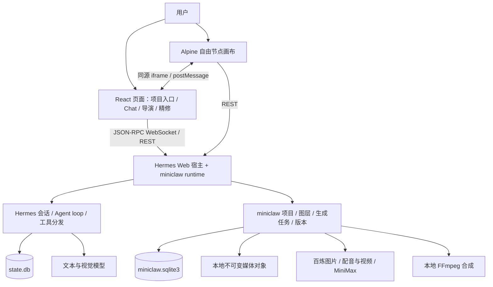

# miniclaw 项目交接与 AI 上手文档

> 状态快照：2026-10-08。面向第一次接手本项目的开发者或 AI。
> 本文依据当前工作区代码、启动脚本和近期验收记录编写。它描述现有实现，不代表未来功能承诺，也不表示作品质量已获用户认可。

## 1. 先用一分钟理解项目

**miniclaw 是基于 Hermes Agent 二次开发的个人产品宣传创作工作台。** 项目起初用于 Agent 工程学习和电商业务实践，目前的业务切入点是产品宣传：让用户围绕真实商品资料，在同一个项目中讨论创意、修图、组织镜头、生成视频、比较候选并导出作品。

Hermes 提供模型调用、Agent loop、工具分发、会话与消息持久化。miniclaw 在其上增加中文 Web 界面、商品创作流程、自由节点画布、图片精修、媒体生成和项目版本管理。

当前主要使用方式是 **项目列表 → 自由画布 → 项目 Chat / 导演助手 → 图片精修或镜头生成 → 比较与采用 → 视频合成及下载**。自由画布、聊天和精修是同一个项目中的不同操作入口。

接手时先记住五件事：

1. 当前自由节点画布在 `frontend/public/studio/`，使用原生 JavaScript 和 Alpine；它不是 React 的 `CanvasApp.tsx`。
2. `CanvasApp.tsx` 是图层与选区精修画布；`StudioDirector.tsx` 是关联项目和当前目标的聊天界面。
3. Chat 原文存在 Hermes 的 `state.db`；项目、任务、附件关联和版本存在 miniclaw 的 `miniclaw.sqlite3`；媒体字节另存文件对象。
4. 候选生成成功后仍须比较、明确采用。修改图片输入不会自动重做已生成的视频。
5. 当前工作区有大量未提交修改和未跟踪文件。只读取 Git HEAD 或远端仓库，可能看不到本文描述的完整实现。

## 2. 背景、业务切入点与成功标准

### 背景

最初项目解决的是“在本机跑通一个可理解、可控制、可保存历史的 Web Agent”。后续围绕电商商品实践，增加图片、口播、封面、字幕与短视频能力。随着实际创作，主流程从固定步骤 Creator 工作台，逐渐转向可以自由组织素材、方案和镜头的节点画布。

普通 Chat 和旧 Creator 仍然存在。它们是基础能力与兼容入口，不能看到旧组件就判断当前产品仍以固定五步骤为中心。

### 当前业务切入点：产品宣传

用户拿着商品原图、产品事实、已有镜头或参考素材，希望减少从“有素材”到“得到可用宣传作品”的反复切换和返工。项目把这些步骤放进可追溯的创作空间：

| 环节 | 用户要解决的问题 | 当前对应能力 |
| --- | --- | --- |
| 明确要求 | 宣传什么、面向谁、哪些事实必须保留 | 项目共同要求、项目 Chat、方案与备注节点 |
| 准备画面 | 调整商品姿态、背景、构图及封面 | 本地变换、选区/SAM、百炼编辑候选、精修版本 |
| 组织镜头 | 哪张图用于哪段视频，如何描述运动 | 镜头节点、输入连线、镜头提示词和模型选择 |
| 生成与审核 | 看得懂结果来源，可以拒绝或继续修改 | 任务状态、实际模型信息、候选比较、明确采用 |
| 形成作品 | 把镜头、口播、字幕组合成可交付文件 | 视频生成、合成、配音/字幕及既有下载打包流程 |
| 后续迭代 | 换方案或恢复旧版本，不丢掉素材和历史 | 保存回执、正式媒体版本、历史查看与恢复 |

当前定位是本地个人工作台。平台发布仍由用户人工完成；自动投放、店铺订单、库存、CRM、多人协作等不属于已实现业务。

### 判断是否做好的标准

- 商品包装、品牌、印刷文字和真实属性必须可信；文案不能替用户编造功效或销量。
- 用户能清楚知道当前编辑对象、生成使用的模型、候选与已采用内容的区别。
- 在同一项目中完成讨论、修改、比较和采用，不因跳页、切换目标或刷新丢失草稿及成果。
- 费用操作有明确意图与次数控制，不因重试、恢复历史或切换模型自动发起生成。
- 界面适合实际创作：层级、字号、间距、长内容、窄屏、状态反馈都要用真实截图检查。
- 最终宣传作品的质量以用户审片和实际效果为准。测试通过与供应商返回成功仅能证明相应工程环节。

## 3. 当前状态与尚未解决的问题

| 领域 | 当前实现 | 实际限制或待验收内容 |
| --- | --- | --- |
| Agent / Chat | 流式对话、停止、历史恢复、工具、技能与设置；项目绑定 Chat | 依赖上游协议与模型能力；侧栏配置不等于每个工具均已实际加载 |
| 自由画布 | 素材/方案/镜头等节点、连线、拖动缩放、选中操作、保存与冲突恢复 | 交互与信息布局仍在根据真实反馈修正 |
| 导演助手 | 复用项目会话，携带 workspace、当前目标及版本上下文，提供提示词/修改建议 | 不应把讨论直接解释为执行；目标切换或绑定失效需中止并保留草稿 |
| 图片精修 | 图层、文字/形状、变换、矩形/套索/笔刷/SAM、候选比较和历史 | 单张合成图不能假定已经无损分离商品与背景 |
| 图片模型 | 界面四项映射到 `qwen-image-2.0-pro`、`qwen-image-2.0`、`qwen-image-edit-max`、`qwen-image-edit-plus` | 路由测试不能证明厂商内部权重；近期 Pro 编辑出现颗粒和姿态不达标，Plus 也未准确完成要求角度 |
| 视频/口播 | 供应商视频任务、镜头采用与合成；既有 FFmpeg、配音、字幕及打包能力 | 不同模型支持的输入模式不同；真实成片仍须审片，不能宣称所有模型/场景均已验收 |
| 次数控制 | 项目图片生成上限支持整数 0–1000，默认 0；记录预留及剩余 | 失败或未知请求仍保留预留；这是应用次数限制，不能当作供应商余额或实际账单 |
| 存储与版本 | 两个 SQLite 库；媒体对象按 hash 去重；正式版本、快照、项目摘要分页 | 当前全部本地存储；没有自动 GC、历史容量配额或完整大文件分片直传 |
| UI | 保留深色画布；近期调整了模型菜单定位、项目资料层级及窄屏阅读顺序 | 用户认为既有排版粗糙；最新局部调整尚待用户视觉验收 |

近期最需要解决的是 **真实商品编辑质量、创作流程清晰度与 UI 完成度**。代码库已有不少功能，不宜仅凭功能数量认定产品成熟，也不宜在没有新需求时继续扩大平台范围。

证据入口：

- [修图质量失败调查](acceptance/49-image-edit-quality.md)
- [模型映射、实际结果来源与核查边界](acceptance/50-image-model-routing.md)
- [生成次数控制与服务重启问题](acceptance/51-image-generation-budget.md)
- [导演与精修联动](acceptance/41-canvas-director-precision.md)
- [媒体对象与版本迁移](acceptance/42-media-storage-versions.md)、[数据库完整性修复](acceptance/43-database-hardening.md)
- [界面设计约定](DESIGN.md)

这些记录是当时的验证快照；同一问题以后续日期的证据和当前代码为准。历史测试数量不应累加成“当前全部通过”。

## 4. 系统结构与边界



### 启动链路

`scripts/miniclaw.ps1 web` 设置本机运行环境 → `scripts/web_entry.py` 导入 Hermes Web 应用 → `miniclaw_web.runtime.install(app, root)` 安装业务服务、REST 路由和 RPC → Hermes 原有启动入口运行该应用。

这是一个宿主中的扩展，不是另起一套聊天 Agent。普通 Web 默认 `127.0.0.1:9120`，同一 Python 服务提供页面和 API。9119 是可选的上游 Dashboard；9170 是旧画布兼容跳转入口，不是当前独立业务后端。

主要接口边界：

| 入口 | 用途 | 实现位置 |
| --- | --- | --- |
| `/api/ws` | Hermes JSON-RPC 连接、对话与事件 | 上游网关；前端 `gateway.ts` |
| RPC `miniclaw.turn.submit` | 校验本轮附件、技能和项目上下文后提交原生 Chat | `runtime.py` |
| `/api/miniclaw/...` | miniclaw 管理、附件、图片精修与旧 Creator 等扩展接口 | `runtime.py`、`canvas_routes.py`、`creator_routes.py` |
| `/api/workspaces/...` | 自由画布项目、保存、Chat 关联、模型、预算、图片/视频任务 | `studio.py` |
| `/api/precision/...` | 自由素材与完整精修编辑器的打开、比较、回填 | `studio.py`、`video_precision.py` |
| `/studio/...` | 自由画布静态文件与媒体读取 | `studio.py` |

API 具体参数以实现与测试为准。不要把上述前缀理解成所有业务都挂在 `/api/miniclaw` 下。

## 5. 目录导航：先读哪些文件

```text
miniclaw/
├─ hermes-agent/               固定版本的官方 Git submodule
├─ frontend/
│  ├─ src/                    React / TypeScript 页面、状态与测试
│  ├─ public/studio/           当前自由节点画布：HTML / JS / CSS / Alpine
│  ├─ precision-workspace.html 精修独立构建入口
│  └─ dist/                   React 构建输出，非源码
├─ miniclaw_web/               Python 业务、REST/RPC 适配与媒体处理
│  └─ schema/                 SQLite 迁移 SQL
├─ plugins/miniclaw-files/     受限文件工具与业务工具接入
├─ skills/                    应用运行时使用的创作技能
├─ scripts/                   安装、启动、初始化、验证和专项迁移
├─ tests/                     Python 业务测试
├─ docs/                      实现说明、验收、数据库和交接文档
├─ workspace/                 Agent 工作目录与教学/工具素材
├─ patches/                   可选上游测试补丁
├─ UPSTREAM.json              上游提交和依赖安装记录
├─ .hermes/                   本机配置、凭据、会话、业务库及媒体（忽略）
├─ .venv/                     Python 虚拟环境（忽略）
└─ runtime.local.json          可选本机 Node / npm / uv 路径（忽略）
```

### 前端文件地图

| 文件或区域 | 职责与阅读提示 |
| --- | --- |
| `src/main.tsx`、`src/AppShell.tsx` | React 启动、URL 参数与模块入口；`director` 参数进入导演界面 |
| `src/StudioHome.tsx`、`src/studio-api.ts` | 项目列表、项目创建与自由画布入口 |
| `src/StudioDirector.tsx`、`src/director-actions.ts` | 项目 Chat、编辑目标、建议和采用操作 |
| `src/chat-controller.ts`、`src/gateway.ts`、`src/transcript.ts` | 对话状态、原生 RPC、事件与历史消息恢复；网关客户端复用 `hermes-agent/apps/shared/src/json-rpc-gateway` |
| `src/CanvasApp.tsx`、`src/canvas-api.ts`、`src/precision-workspace.tsx` | 图片图层精修、选区、历史和独立编辑页面 |
| `src/CreatorWorkspace.tsx` 与 `creator-*` | 早期固定创作流程及兼容能力 |
| `public/studio/index.html` | 自由画布模板、节点/弹层布局、脚本加载顺序 |
| `public/studio/app.js`、`workflow.js`、`usability.js` | 画布基础状态与流程/交互支持 |
| `public/studio/integration.js` | 项目 API、Chat/导演/精修联动、版本与次数设置 |
| `public/studio/production.js` | 项目/结果节点、连线与拖动等生产交互扩展 |
| `public/studio/node-composer.js` | 节点编辑面板、生成输入、模型选择等 |
| `public/studio/interaction.js` | 选中目标、菜单、导演消息和项目资料等交互扩展 |
| `public/studio/style.css`、`node-composer.css`、`workbench.css` | 自由画布样式；后加载的样式可能覆盖前面的规则 |

**重要：自由画布依赖脚本加载顺序。** 多个文件通过包装 `window.film` 扩充同一个 Alpine 状态对象，不能把它们当作完全独立的 ES 模块。当前顺序为：

`project-name.js → usability.js → workflow.js → app.js → integration.js → production.js → node-composer.js → interaction.js → Alpine`。

修改某个方法时，要找出后续包装是否覆盖或调用它；修改菜单、弹层定位时，要同时检查模板绑定、计算坐标与 CSS。

### 后端文件地图

| 文件或区域 | 职责 |
| --- | --- |
| `runtime.py` | 宿主扩展装配、工具/技能配置、附件与上下文校验、原生 Chat 提交和展示 sidecar |
| `store.py`、`attachments.py`、`context.py` | 业务连接与元数据、附件处理、上下文诊断 |
| `studio.py`、`studio_projects.py` | 自由画布业务入口、项目摘要、Chat 关联、图片预算/请求和 REST/静态路由 |
| `video_workspace.py` | 画布状态保存、revision 冲突、request_id 幂等回执与快照 |
| `video_precision.py` | 自由素材与图层精修文档的关联、比较和采用 |
| `canvas.py`、`canvas_document.py`、`canvas_routes.py`、`canvas_tools.py` | 精修文档、历史、选区、任务、API 与 Agent 工具 |
| `image_plans.py`、`image_provider.py`、`segmentation.py`、`screenshot_crop.py` | 修改方案、百炼图像适配、SAM 与裁图 |
| `media_models.py`、`generation_audit.py` | 模型能力/估价描述、生成记录与审计支持 |
| `studio_video.py`、`minimax_video.py` | 当前项目视频任务、采用、合成与 MiniMax 适配 |
| `creator.py`、`creator_routes.py`、`creation.py`、`decisions.py` | 旧 Creator 项目、任务及方案/决策能力 |
| `video.py`、`storyboard.py`、`narrated.py`、`overlay.py` | 本地合成、分镜、配音字幕与动效编排 |
| `media_storage.py`、`media_versions.py` | 不可变文件对象、访问范围、正式媒体版本与快照 |
| `pagination.py`、`storage_migration.py`、`schema/` | 分页、存量迁移与结构完整性 |

`runtime.py` 和 `studio.py` 承担较多跨领域装配；自由画布又有逐层包装。这里是理解和修改时的主要阅读成本，本文仅记录现状，没有实施重构。

## 6. 核心业务术语：不要混用这些 ID

| 术语 | 本项目含义 |
| --- | --- |
| workspace | 自由节点画布项目，保存素材、镜头、方案、布局及序列等状态 |
| canvas project | 完整图层精修文档；可由 workspace 的一个素材关联打开 |
| Hermes session / chat_id | 原生持久对话；项目通过关联使用它，一个对话可关联多个项目，每轮仍须携带明确项目上下文 |
| creator project | 早期固定创作流程项目；不等同于 workspace |
| asset | 商品原图或创作素材，有内容身份、当前文件和版本；不是某个 DOM 节点 |
| shot | 镜头输入与生成要求，包括引用素材、提示词、模式和模型；不是已生成视频 |
| candidate | 未采用的图片/视频候选；生成成功不代表已成为项目当前内容 |
| adopted result | 用户明确采用的结果；合成应读取确切采用版本 |
| file object | 按内容 hash 标识的不可变文件字节，可被多个内容或项目引用 |
| media revision / head | 正式内容版本 / 当前版本指针；与画布保存 revision 不同 |
| revision | 当前画布状态的乐观并发版本；过期保存应报冲突 |
| request_id | 应用请求幂等标识；同一标识不能配不同请求内容 |
| provider request ID | 供应商返回的任务/请求标识；用于查任务及核查，不替代应用 request_id |
| reserved | 已预留图片生成次数，包含失败或状态未知请求；不是成功图片数量 |

例如：用户选中一张商品素材 → 打开与它关联的 canvas project → 生成 candidate → 比较并采用 → 更新 workspace 中该 asset 的当前输入。已生成的 shot 视频继续保留原输入来源，只有明确重做才重新调用供应商。

## 7. 状态、媒体与数据完整性

默认日常启动使用仓库下 `.hermes/`。启动器设置 `HERMES_HOME`，当前 `runtime.install` 也直接用 `root/.hermes` 创建业务 Store；迁移到其他 profile 时必须核对这两处，不能假定只改环境变量就完成迁移。

| 保存位置 | 内容与归属 |
| --- | --- |
| `.hermes/state.db` | Hermes 原生会话、消息、检索及运行数据；上游维护 schema |
| `.hermes/miniclaw.sqlite3` | miniclaw 项目、附件关联、图层、生成任务、文件索引和版本 |
| `.hermes/media/objects/sha256/<prefix>/<hash>` | 去重的不可变媒体字节；数据库存 object ID、backend、key、hash 等 |
| `.hermes/media/staging/`、`media/cache/` | 临时写入与处理缓存 |
| 旧图片/附件/视频目录 | 兼容读取及生成工作目录；本次存储迁移未删除旧文件 |
| 浏览器 localStorage / sessionStorage / IndexedDB | 草稿、布局缓存、待保存内容与恢复备份；已保存正式状态以业务库为准 |

业务库当前结构为 32 张表。完整表分组、DDL、外键、触发器和迁移记录见 [数据库文档](database/README.md)。节点与图层保留文档 JSON；文件、版本及查询索引另存关系表。没有 Redis。

必须保留的行为：

- 保存通过事务、revision 校验和幂等回执防止覆盖或重复提交。遇到其他窗口修改不能静默强行覆盖。
- 正式版本和文件对象不可变；恢复切换 head，后续编辑追加版本。快捷撤销历史与正式媒体历史是两种机制。
- 删除节点不会自动删除其所有正式版本和文件；未来清理必须考虑 Chat、任务、快照和回执引用。
- 项目与 Chat 跨两个数据库关联，由应用校验，不能伪造跨库外键或缺失的旧消息版本。
- Chat 原文以原生消息为准，`turns` 等 sidecar 保存展示与素材关联，不应变成第二套聊天历史。
- 原生发送已经成功而 sidecar 写入失败时，应提示关联失败，不能为补关联自动重发同一条对话。
- 视频与成片固定实际输入对象/版本；供应商请求字段和当前下拉选择都不能替代既有结果的来源。
- 当前图片上传仍有 5 MiB 等入口校验；底层大对象流式测试不等于所有上传入口已支持大文件。

当前实现本地对象后端。OSS 接口扩展点已预留，但 SDK、凭据配置、签名访问、分片直传尚未接入。备份必须包含两个库及对应媒体；仅复制 SQLite 不能保证作品可恢复。

## 8. 本机启动与验证

### 安装和运行

当前脚本面向 Windows PowerShell。需要 Git、Node.js 22.12+（项目安装说明推荐 24 LTS）和 uv。Python 使用 3.12，具体版本与上游提交记录在 [UPSTREAM.json](../UPSTREAM.json)。

首次获取应带上 submodule；已有工作区先检查状态，再决定是否安装，避免把现有修改当作需要重置的脏文件。

```powershell
git clone --recurse-submodules --shallow-submodules https://github.com/buyuxixi/miniclaw.git
cd miniclaw
.\scripts\setup.ps1
.\scripts\miniclaw.ps1 build
.\scripts\miniclaw.ps1 web
```

模型凭据由本地 `.hermes/.env` 等服务端配置读取。文本聊天、图片、视频供应商分别需要对应配置；没有配置不代表所有本地编辑功能不可用。不要把真实 Key、完整会话库或私有商品素材粘进交接提示词。

打开 `http://127.0.0.1:9120/`；自由画布路径是 `/studio/index.html`。Python 终端保持运行。普通 miniclaw Web 不需要构建上游 Dashboard。

### 修改后怎样让代码生效

| 修改范围 | 生效动作 |
| --- | --- |
| `frontend/src/` React / TS | 运行 `miniclaw.ps1 build`，刷新浏览器加载新构建 |
| `frontend/public/studio/` HTML / JS / CSS | 当前服务从源码目录直接提供，并加版本参数/no-store；刷新页面检查实际响应 |
| Python 后端、插件或服务端环境配置 | 停止旧服务后重新启动，确认实际监听进程使用新代码 |
| 应用技能文件 | 检查应用安装副本、绑定/hash 与加载状态；仓库文件改了不一定等于当前对话已经读取新版 |

近期次数设置曾遇到“源代码已修复，运行中的旧 Python 服务仍执行旧逻辑”。复现问题时先查加载版本和进程，避免重复改对的代码或反复提交生成。

### 测试入口

```powershell
# 根目录：既有离线检查集合与全部前端测试
.\scripts\miniclaw.ps1 test

# 根目录：自由画布、模型路由、对象存储与 schema 的专项测试示例
# 对当前 PowerShell 会话设置项目和上游 import 路径
$env:PYTHONPATH = "$PWD;$PWD\hermes-agent"
.\.venv\Scripts\python.exe -m unittest tests.test_studio tests.test_studio_models tests.test_media_storage tests.test_schema_hardening

# frontend 目录：针对实际改动选择行为测试
npm test -- src/studio-operations.test.js src/studio-save.test.js
npm run build
```

`miniclaw.ps1 test` 的 Python 列表是显式列出的既有集合，不会自动包含所有新测试文件；修改新模块时需另外运行对应专项检查。生成/审片脚本中有些会真实调用供应商，应先读脚本，不能把它们当作普通离线单测。

本文本轮仅核对代码、文档与链接，没有重新运行全套工程测试或调用收费模型。今后交接状态应写明执行命令、结果、验证范围，以及用户是否验收视觉和作品。

## 9. 上游、技能与开发约定

### 上游依赖

`hermes-agent/` 固定在 `v2026.9.24`，提交 `f97608f178d1ffeca59860195ab7da295f7c8e5f`。精确安装方式见 `UPSTREAM.json` 与启动脚本。

miniclaw 通过扩展安装接入上游，生产核心保持官方实现。当前本机 submodule 另有 ConPTY 测试修改；仓库提供可选测试 patch，不能因此宣称所有上游文件完全无修改。升级需核对共享客户端、RPC 契约、工具配置、历史恢复和启动入口。

### 两类技能

- 仓库 `skills/`：给 miniclaw 内部 Agent 使用的商品修图、画布、封面、口播、分镜、提示词与字幕编排技能，结合 prepare/应用管理与绑定生效。
- 本机 Codex skills：给开发本项目的 AI 使用。用户要求 UI 工作使用 `oil-ui-pro`；当前本机已升级到 0.17.0，项目约定见 [DESIGN.md](DESIGN.md)。本轮另安装了 `improve-codebase-architecture`，用于后续架构审查，安装在用户 Codex 技能目录。

这两类安装位置和权限不同。接手模型在其他机器上不会因为克隆项目就自动获得本机 Codex skills。本轮架构技能安装不表示已经执行其完整审查或重构流程。

### 接手后的工作约定

1. 先执行 `git status --short`，保留已有修改和未跟踪文件；不要为了得到干净树而 reset、clean 或覆盖用户资料。
2. 针对当前用户问题选阅读范围。自由画布 UI 先读 `public/studio`；精修先读 `CanvasApp` / `canvas`；Chat 先读 controller / runtime / 上游契约。
3. 不新增一套平行聊天、存储或任务真相；复用当前正式项目和会话。
4. 云端生成、候选采用、版本恢复和覆盖保存是不同操作，界面与后端都要表达清楚。
5. UI 修改读取 oil 技能及 `DESIGN.md`，检查真实桌面与窄屏截图；不能只因构建成功就报告视觉通过。
6. 对本地几何编辑与云端生成分别验证。提示词优化并不保证包装保真，也不能替代任务模型映射检查。
7. 先做与当前需求相关的小改动；涉及存储迁移、跨库关联、幂等或供应商请求时，再扩大验证范围。
8. 验收文档必须区分源码修复、运行服务生效、离线测试、真实云端调用与用户效果验收。

## 10. 建议阅读顺序与可直接复制的交接提示词

推荐第一次接手按以下顺序阅读：

1. 本文，掌握业务目标、主要入口和术语。
2. [README](../README.md) 与 `scripts/miniclaw.ps1`，理解安装和宿主启动。
3. `frontend/src/main.tsx`、`AppShell.tsx`，以及 `frontend/public/studio/index.html`，确认两套前端如何连接。
4. `miniclaw_web/runtime.py`、`studio.py`、`video_workspace.py`，掌握装配、API 和保存。
5. [数据库文档](database/README.md) 与 `media_storage.py` / `media_versions.py`，理解媒体真相与版本保护。
6. [DESIGN.md](DESIGN.md)、当前任务相关的验收记录；再进入具体模块及对应测试。

[进度总表](project-progress.md) 和早期 Creator 验收记录用于了解演进，不替代当前代码。若内容冲突，核对日期、真实路由和运行响应后记录差异。

下面这段可直接交给另一个模型：

```text
请先阅读 docs/AI-ONBOARDING.md，再检查当前工作区 git status 和相关源代码。
这是基于 Hermes Agent 的本地个人产品宣传创作工作台，当前主线是自由节点画布、同项目 Chat/导演、图片精修、镜头生成、比较采用与合成。
请区分 frontend/public/studio 的 Alpine 自由画布、React CanvasApp 的图层精修、Hermes 原生会话，以及旧 Creator 兼容流程。
只读远端或 Git HEAD 可能缺少当前未提交/未跟踪实现；不要丢弃既有改动。
请先向我说明你理解的业务目标、当前架构、数据真相和当前任务的相关模块，再按我给的具体任务工作。
不要自动调用收费生成，不要把测试通过写成用户质量验收，也不要为了熟悉代码主动进行重构。
若涉及 UI，请使用已安装的 oil-ui-pro，并读取 docs/DESIGN.md；若缺少本机技能，应明确说明。
```
