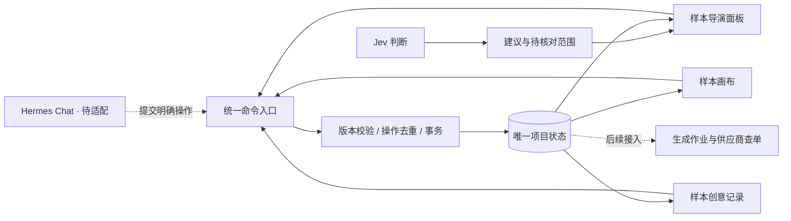

# 同一创作任务的状态联动验证台

> **2026-10-07 用户评审：本轮 UI 被否定，撤回主设计推荐。** 自由画布被替换成固定三镜头陈列，自由 Chat 被弱化为想法记录，入口不清；内部评分与状态测试不能证明产品形态正确。本目录仅保留技术验证证据，不作为正式 UI 基线。继续基于 `outputs/2026-10-07-video-workspace/` 的视频创作画布方向完善，原有自由度、导演能力、Chat 桥接与精修缺口仍需解决。

2026-10-07。本轮是技术与交互验证切片，尚未替换正式 React 工作区，也没有接管 Hermes 的会话循环。既有的“视频片段与成片主线”定位继续保留；截图中的静态帧用于验证镜头采用关系，不能代表新视频已经生成。

## 打开与重跑

在项目根执行：

```powershell
.\.venv\Scripts\python.exe scripts/creation_lab.py
```

- 工作区：http://127.0.0.1:9182/
- Oil UI 双方向对比：http://127.0.0.1:9182/comparison
- 界面源与证据：`outputs/2026-10-07-creation-lab/`。这些是本机输出，默认不跟踪到 Git；交接时需要同时保留这个目录。
- 状态库：`.hermes/creation-lab/miniclaw.sqlite3`，与正式项目隔离。
- 凭据：后端从 `.hermes/.env` 读取 `JEV_API`，兼容 `JEV_API_KEY` / `TYPESAFE_API_KEY`。不把值写入网页或报告。
- 服务只监听回环地址，写接口需当前页面令牌并校验来源；不是面向公网部署的鉴权设计。

## 这次真正实现的内容



项目状态由程序负责；模型提供建议，界面呈现同一份事实。把“能否改变状态”和“建议如何改变状态”分开，后续替换模型时就不必重写恢复、预算和版本规则。

`miniclaw_web/creation.py` 管理一个持久化项目：事实、镜头版本、当前采用、修改提案、讨论和事件。讨论、导演面板和画布都提交到同一个命令入口。请求包含稳定操作 ID 和项目版本；重复请求返回回执，过期版本报冲突。项目与回执在同一事务中写入。

“只改第二镜头”的路径：明确目标 → 保存提案 → 从已有素材选择候选 → 核对后采用 → 必要时恢复旧版。提案保存镜头版本，迟到候选不能覆盖更新后的镜头。恢复会增加版本号，保留已有候选；不会倒退版本号。实际图片修改仅使用原图的确定性裁切，未提交图像或视频生成。

样本内的“创意讨论”是项目想法记录，可带入导演面板；它还不是 Hermes 的模型对话。打开 Hermes 的链接保留原入口，但正式 Chat 与本服务的事实/操作桥接尚待实现，不能声称三个正式产品入口已经打通。

`miniclaw_web/decisions.py` 接入官方 TypeSafe System One API，固定 `jev-1.13.0`。一次判断同时询问操作类型、作用对象、保留其他镜头、产品事实是否需要核对。输入只取必要项目快照；输出经过枚举、概率与结构校验。Jev 不直接写项目，置信度也不代替业务校验。

## 工程边界

| 风险 | 当前处理 | 尚未覆盖 |
|---|---|---|
| 重复提交 | 固定请求 ID、持久化回执、前端保留未知请求 | 本机输入草稿刷新恢复；跨设备和未知请求 ID 跨刷新恢复尚未实现 |
| 并发修改 | 项目版本比较；采用时再检查镜头版本 | 正式 Hermes 的命令适配 |
| 本地写入失败 | 同一事务回滚，原版本保留 | 磁盘满的用户引导与运维告警 |
| 断网或决策超时 | 返回未知；同 ID 不重发；仍可手工选择候选 | 供应商查单与生成任务恢复 |
| 进程中断 | 项目和回执重启恢复；过期 pending 返回 unknown | 后台作业调度器 |
| 预算 | 调用前事务预留；调用数和费用估计双限制 | 最终账单对账、多供应商生成预算 |
| 复杂指令 | 识别复合要求后阻止 UI 一键建立单镜头替换提案 | 逐项拆解、冲突澄清与主模型升级 |

样本交互预算上限 20 次或估计 $0.05（先到者生效），不是按次打开页面重置。评估独立限制 8 次 / $0.01。费用采用官方输入单价 $0.042/百万 token 的估计；未知响应保留预留额，不把未知当作零花费。价格估计不保证与供应商账单一致。没有任何视频生成预算支出。

## 真实 Jev 样例结果

固定样本评估 8 次，估计 $0.000345；浏览器端到端判断 1 次，耗时 1250 ms，估计 $0.000044。本轮共 9 次，估计 **$0.000389**。未进行主模型或规则的对照实验，未证明 Jev 优于其他方案。

8 条中有 6 条与初始标签完全相同。两个差异不能简单归因于模型：

1. 复合样例同时要求“开场和结尾不动”与“结尾多停一秒”，标签却直接指定 multiple，缺少冲突澄清。模型识别了 compound，但目标仅选第二镜头。
2. 移动画布卡片被正确识别为 layout，但目标选第二镜头，标签为 none。问题把操作对象与内容影响混在了一起；口播目标的样例与 none 定义也存在冲突。

下一版先把 `operation_target` 与 `content_impact` 分开，增加逐镜头影响和矛盾检测，并修正标签；再在冻结的中文样例上比较主模型、规则和 Jev。不得修改本轮原始报告来制造更高分数。当前 0.65 阈值只是保护性初值，未经业务校准。

原始报告：`outputs/2026-10-07-creation-lab/jev-evaluation.json`。`scripts/evaluate_jev.py --live` 使用固定 scope 和请求 ID，已有结果会重放而不重复计费；未提供 `--live` 时拒绝调用。

## Skill 下一步适配契约

本轮没有改写既有技能或扩大工具权限。后续首先对齐输入/输出，而不是增加 agent：

| 模块 | 程序提供的输入 | 技能应返回 | 程序必须执行 |
|---|---|---|---|
| 导演规划 | 必要事实、镜头快照、用户要求、预算 | 分项修改提案、影响范围、缺失信息 | 目标校验、冲突检查、预算授权 |
| product-image-edit | 素材 ID/版本、选区、保留要求 | 新素材候选与来源 | 落盘、版本登记、显式采用 |
| spoken-script | 已确认事实、口播段落、时长限制 | 口播候选、待核实表述 | 段落版本校验、配音任务计费 |
| 提示词模块 | 已确认提案、目标模型能力 | 与供应商参数匹配的提示词 | 参数校验、执行与结果关联 |

LibTV 的公开 skill 是其创作服务调用封装，不能据此声称拿到了内部导演技能。MiniMax 的 `h3-prompt-writing` 可作为提示词方法参考；依赖其 Hub 的技能不能直接搬进本项目。

## 验证记录

- 既有 creator 基线：12 项通过。
- `python -m unittest discover -s tests -p 'test_creation*.py'`：最终 14 项连续三次通过，覆盖三入口共用状态、局部修改、恢复、重复请求、冲突、迟到候选、故障回滚、接口来源限制、低置信度、异常响应、超时、重启与预算。
- 浏览器实际操作：创建提案 → 选择原图裁切 → 采用 → 刷新 → 恢复 → 再采用；服务重启后保留状态；创意讨论保存成功；真实 Jev 判断返回；过期页面提交被拒绝后，刷新恢复未提交草稿且项目仍为 v17；没有自动改变作品。
- Oil UI 0.16.5：两方向 1440×1000 / 390×844 和 200% 检查通过，无脚本错误、横向溢出或失败图片。首次出场、切换、主操作留存连续帧，环境未提供可用 ffmpeg，因此未输出 MP4。独立视觉评审结果另见输出目录 `visual-review.md`、`visual-review-final.md` 与 `visual-review-delivery.md`；不以内部评分替代用户认可。故障恢复已实际走查页面过期场景，但未覆盖所有故障 UI，也未保存该场景的文件截图。
- 未运行全仓测试或生产构建；没有更改正式前端入口。

## 一手参考

- [TypeSafe API](https://docs.typesafe.ai/api)
- [Jev 模型与价格](https://docs.typesafe.ai/models)
- [Jev 局限](https://docs.typesafe.ai/model-jaggedness/jev-1.13)
- [LibTV Skills](https://github.com/libtv-labs/libtv-skills)
- [MiniMax H3](https://github.com/MiniMax-AI/MiniMax-H3)


### 评审收尾

三轮独立视觉评审已结束，最终两方向8/10，推荐浅色创作桌；按 Oil UI 三轮上限停止评分循环。保留有限问题：部分动效中间态和异常流程缺可存档截图，不能当正式产品完整验收。第三轮指出切镜头后旧草稿目标不清，随后已补目标绑定：切到不同镜头出现提示，辅助判断与提交禁用，返回原镜头恢复操作，重新输入才建立新目标。Cua 实际往返通过，`delivery-scope-guard/` 桌面与手机截图检查通过；该局部收尾由主代理复核，未另开第四轮评分。
